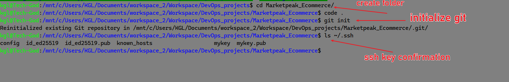
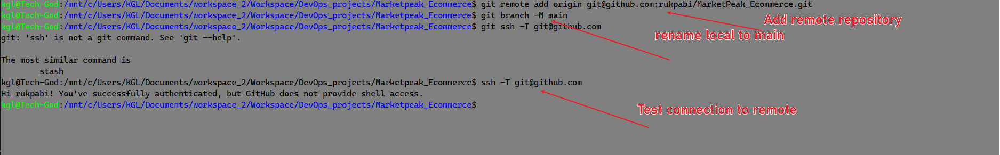

INTRODUTION TO CLOUD COMPUTING

MARKETPEAK_ECOMMERCE PROJECT
You have been assigned to develop an e-commerce website for a new online marketplace named "MarketPeak." This platform will feature product listings, a shopping cart, and user authentication. Your objective is to utilize Git for version control, develop the platform in a Linux environment, and deploy it on an AWS EC2 instance. You can find a suitable website template here to kickstart your development.

Task
The project task is divided into 3 major parts
### 1.Creating the repoistory and downloading the website template
### 2.Launching an EC2 instance and installing apache to host the website
### 3.Connect the EC2 instance to the remote github to carry out version control on the website.

## Creating the repoistory and downloading the website template

1. We will initialize a local git repository (Marketpeak_Ecommerce)

2. Create and add remote repository to local

3. Download website template for use and extract files into the marketpeak_ecommerce folder

4. Commit and push to the remote repository
